# Visão do produto e fases

Este documento diz para onde o Cortex vai e em que ordem. Ele é um plano: quase
nada daqui existe ainda. O que o app faz hoje está em [`docs/SPEC.md`](../SPEC.md);
o que cada fase entrega, em issues, está nos [marcos](https://github.com/viczy-guy/cortex/milestones).

Os desenhos são rascunhos para discussão, não o layout final.

- [As duas frentes](#as-duas-frentes)
- [Fases](#fases)
- [A nova ilha](#a-nova-ilha) (fase A2)
- [Pedir pela ilha](#pedir-pela-ilha) (fase A4)
- [Agir nos PRs](#agir-nos-prs) (fase A6)
- [A plataforma](#a-plataforma) (trilha P, depois do app)
- [Como as mudanças chegam](#como-as-mudanças-chegam)
- [Regras de segurança](#regras-de-segurança)
- [Em aberto](#em-aberto)

## As duas frentes

O foco é o app na máquina: o assistente de uma pessoa, com os agentes dela. A
plataforma vem depois, para times, e o app é moldado desde já para encaixar nela.

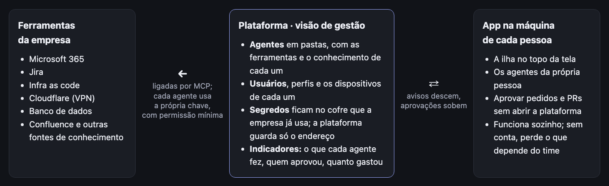

A regra da divisão: o que uma pessoa precisa para si fica no app. O que um
coordenador precisa saber ou controlar sobre os outros fica na plataforma.

O app continua funcionando sozinho, sem conta e sem servidor. Conectar a uma
plataforma é opcional, só chega na fase A8 e pede uma decisão de arquitetura
nova no lugar da [ADR 0002](../adr/0002-no-server.md).

## Fases

### Trilha do app

| Fase | Versão | O que entrega | Pronto quando |
|---|---|---|---|
| A0 | v0.2.0 | Consolidação: socket com limites, instaladores abertos em máquinas limpas | Publicada em 21/11/2026 |
| A1 | [v0.2.x](https://github.com/viczy-guy/cortex/milestone/5) | Manutenção: SPEC em dia, duas cópias abertas, encerrar o app com facilidade, Actions atualizadas | A SPEC e o app não divergem |
| A2 | [v0.3.0](https://github.com/viczy-guy/cortex/milestone/6) | Nova ilha: formato do recorte da câmera, posições, até 4 agentes com cor de estado, mascote, sons, tela de abertura | A ilha é vista sem procurar |
| A2b | [v0.4.0](https://github.com/viczy-guy/cortex/milestone/15) | Avisos na ilha: uma cor e uma frase curta por acontecimento (azul pediram sua revisão, verde pronto, âmbar agente precisa de você, vermelho PR ou action falhou, ou plan que destrói); a frase fica uns segundos, passar o mouse lista os avisos | Ser marcado como revisor acende a ilha em azul com a frase. Desenho: `Cortex-plano/avisos.html` |
| A2c | [v0.5.0](https://github.com/viczy-guy/cortex/milestone/19) | Mascote vivo: segue o mouse, pisca, cochila e reage ao clique e às cores; mascotes novos (caveira, ninja, mochi coelho, mochi samurai) | O mascote olha para onde está o mouse sem custar CPU parado. Desenho: `Cortex-plano/mascote.html` |
| A3 | [v0.6.0](https://github.com/viczy-guy/cortex/milestone/7) | Atualiza sozinho, nome novo: atualização sem clique, canal de teste e canal estável (as telas de atualização saíram na 0.3.2) | Uma versão chega a todas as máquinas sem ninguém clicar |
| A4 | [v0.7.0](https://github.com/viczy-guy/cortex/milestone/8) | Pedir pela ilha: caixa de pedido, com escolha do agente, do modelo e da pasta | Dá-se uma ordem a um agente sem abrir o terminal |
| A5 | [v0.8.0](https://github.com/viczy-guy/cortex/milestone/9) | Mais agentes: Codex CLI e Gemini CLI, agente que chama outro, regras por agente e por pasta, card vermelho | Um agente que não é o Claude Code pede aprovação pela ilha |
| A6 | [v0.9.0](https://github.com/viczy-guy/cortex/milestone/10) | Agir nos PRs: aviso de pedido de revisão, análise do agente, aprovar ou pedir mudanças | Um coordenador aprova um PR sem abrir o GitHub |
| A7 | [v0.10.0](https://github.com/viczy-guy/cortex/milestone/11) | Seus agentes: receita com IA, pasta, instruções, ferramentas e fontes | Cria-se um agente com receita própria e ele é chamado pela ilha |
| A8 | [v1.0](https://github.com/viczy-guy/cortex/milestone/2) | App conectado: conta opcional, avisos e aprovações de agentes do servidor, Windows e Linux testados por gente | Encontra a fase P3 |

### Trilha da plataforma

Fica para depois da trilha do app. Está mapeada no marco
[Plataforma](https://github.com/viczy-guy/cortex/milestone/12).

| Fase | O que entrega | Pronto quando |
|---|---|---|
| P0 | Spec e decisões, só texto: o que a plataforma é e o que não é, de quais cofres ela sabe ler, os quatro perfis | A spec foi aprovada. Nenhum código antes |
| P1 | Esqueleto: roda em servidor Linux ou em Kubernetes, entrada pelo provedor de identidade, guia Usuários, Meu perfil, primeiros passos, API para tudo o que a tela faz | Entra-se com a conta da empresa e vê-se quem tem o app |
| P2 | Painel de agentes: pastas, fluxo, ferramentas e conhecimento, segredo por referência ao cofre, Indicadores | Um agente real aparece trabalhando no painel |
| P3 | Aprovação pela ilha: o agente do servidor pede e o card aparece na máquina do coordenador | Encontra a fase A8 |
| P4 | Gestores e relatórios: agente gestor e tester por pasta, relatório mensal, liberar versão do app para todas as máquinas | O primeiro relatório sai sem ajuda |
| P5 | Tudo por código: agentes, pastas, ferramentas e perfis pelo Terragrunt; importar o que foi feito à mão | Um agente novo nasce de um PR aprovado |

Rede e VPN ficam fora: seriam uma extensão à parte.

## A nova ilha

Hoje a ilha recolhida é uma alça de poucos pixels, que quase não se vê. A nova
tem o formato do recorte da câmera do MacBook: um recorte preto no topo da tela,
com o mascote sempre ali, que reage ao mouse.

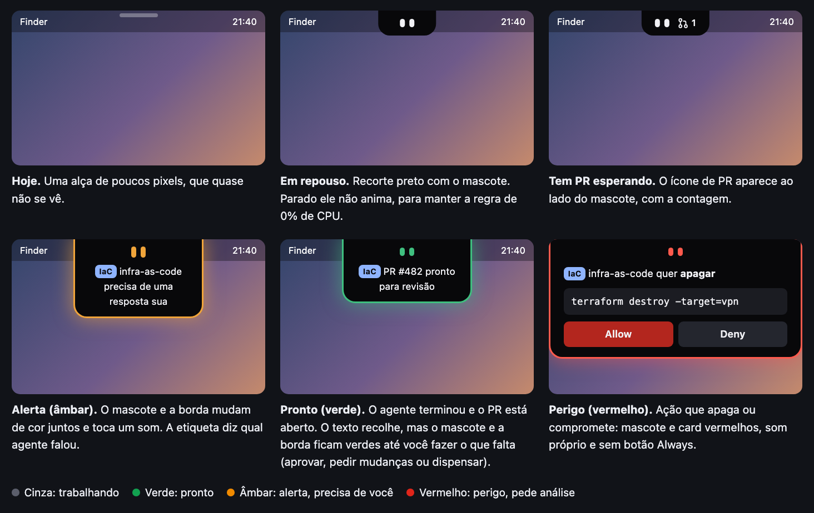

As cores têm um significado só, no mascote e na borda ao mesmo tempo:

| Cor | Significa | Som |
|---|---|---|
| Cinza | O agente está trabalhando | Nenhum |
| Verde | Pronto: o agente terminou, o PR está aberto | Três notas subindo, duas vezes |
| Âmbar | Alerta: precisa de uma resposta sua | Três batidas graves e um toque, duas vezes |
| Vermelho | Perigo: ação que apaga ou compromete | Sirene, uma vez |

A cor fica até a pessoa fazer o que falta. Som e mascote vêm ligados, e cada um
tem o seu botão de desligar. Parada, a ilha não anima: a regra de 0% de CPU continua.

### Vários agentes

Lado a lado, no máximo quatro; o resto vira um contador. Quem precisa de você
passa para a frente. Quando um agente chama outro, o segundo aparece preso ao primeiro.

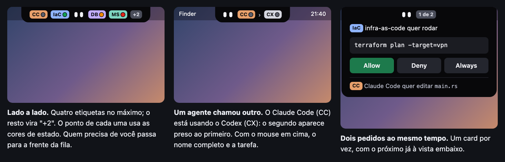

### Onde a ilha fica

Na tela do MacBook o meio do recorte é a câmera de verdade: ali não existe tela,
então a ilha cresce para os lados e os cards descem por baixo. No monitor externo
ela desenha o próprio recorte. Em Settings escolhe-se a tela e uma de cinco posições.

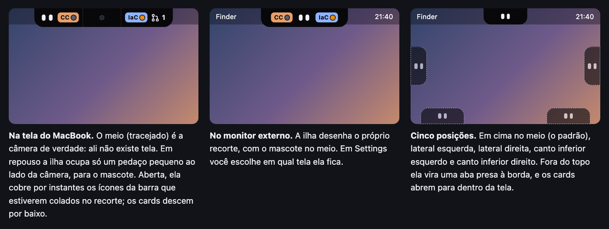

### Tela de abertura e de atualização

Ao abrir: um ponto cresce mudando de cor, aparece "Seja bem-vindo", ele some, e
entram "Vamos trabalhar?" e o mascote. A versão do app fica no pé da tela. Abrir
junto com o computador é uma opção em Settings.

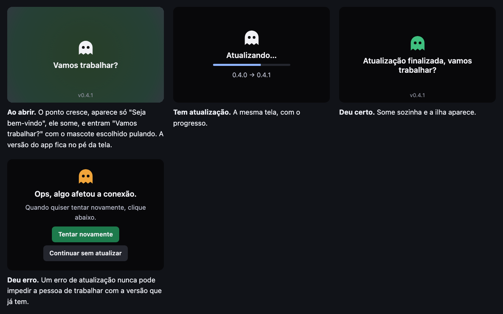

### Mascote

A pessoa escolhe. A mesma galeria dá o ícone de cada agente na plataforma.

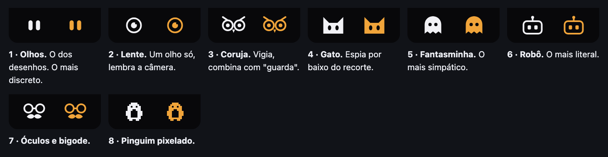

## Pedir pela ilha

Um clique no mascote abre uma caixa de pedido. Escolhe-se quem atende (Claude
Code, Codex ou um agente da própria pessoa), o modelo e a pasta. O agente roda
pelos programas já instalados e logados na máquina, com a assinatura da pessoa.

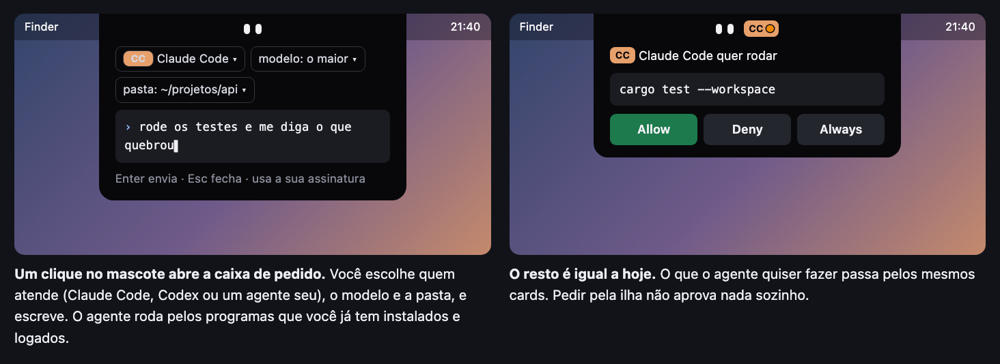

Isto muda o que o app é: hoje ele só observa agentes, e aqui passa a iniciá-los.
Duas regras vêm junto: pedir pela ilha não aprova nada sozinho, e tudo o que o
agente quiser fazer passa pelos mesmos cards.

## Agir nos PRs

O app avisa quando alguém pede a sua revisão, com a foto e o nome de quem pediu.
O card do PR traz a análise do agente, num formato configurável, e os botões.

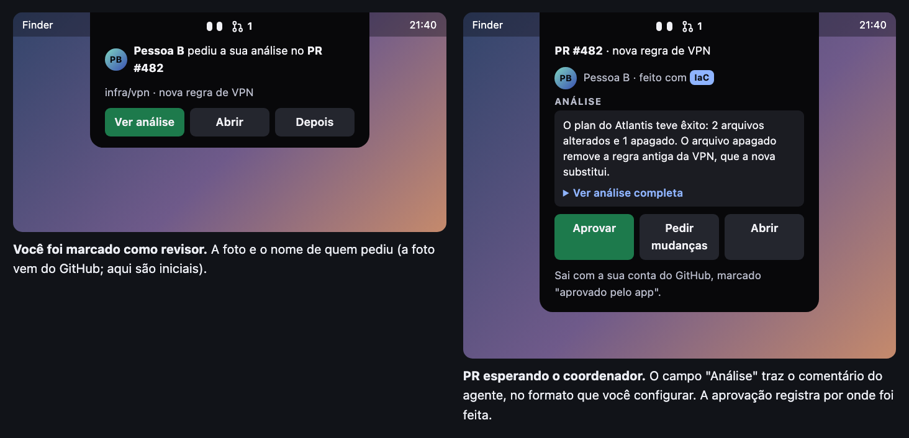

A aprovação sai com a conta do GitHub de quem aprovou e leva a marca de que foi
feita pelo app. É a primeira vez que o app escreve no GitHub.

## A plataforma

### Agentes em pastas, com o fluxo dentro

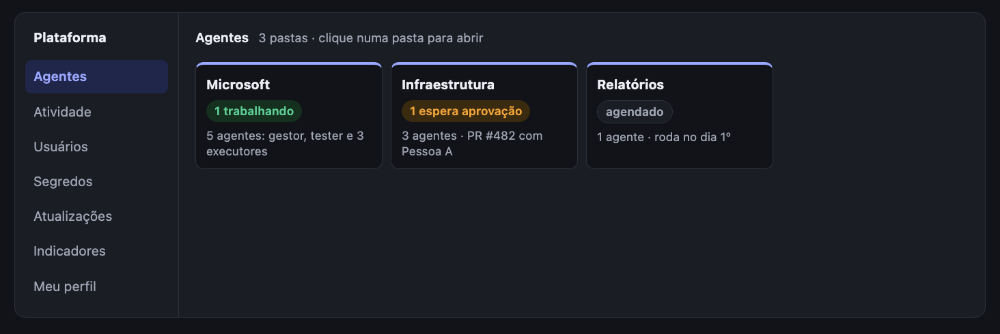

Dentro da pasta, quem passa o trabalho para quem. A demanda desce do gestor para
os executores; o resultado sobe pelo tester até o gestor, e dele para uma pessoa.
Começa com formatos prontos de fluxo, sem editor livre.

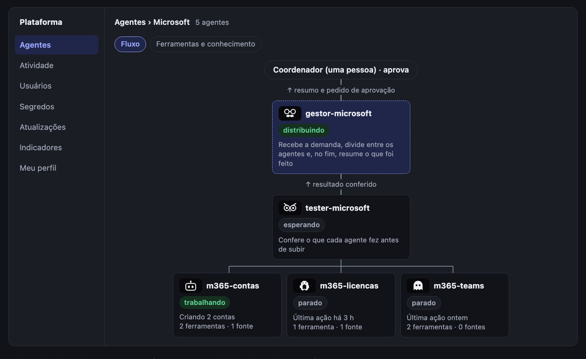

Na mesma pasta, as ferramentas (MCP) e as fontes de conhecimento (RAG), com quem
usa cada uma. "Pode alterar" aparece em destaque.

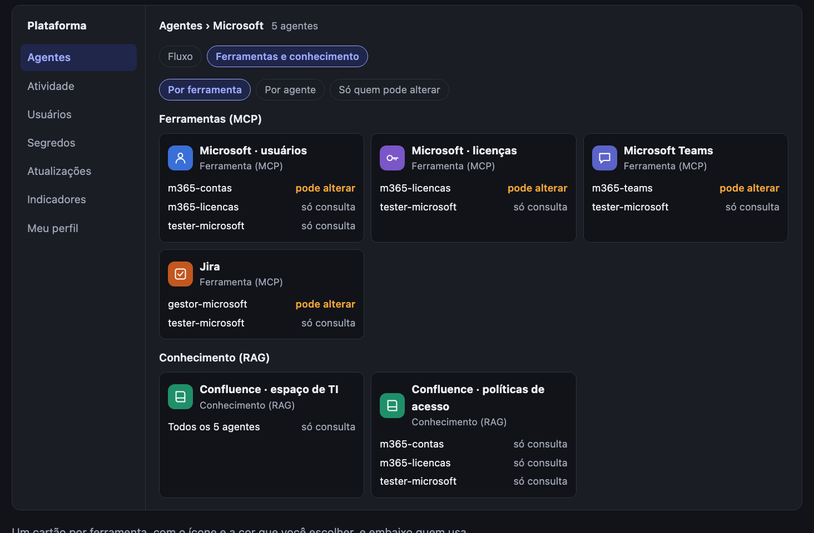

### Usuários, perfis e dispositivos

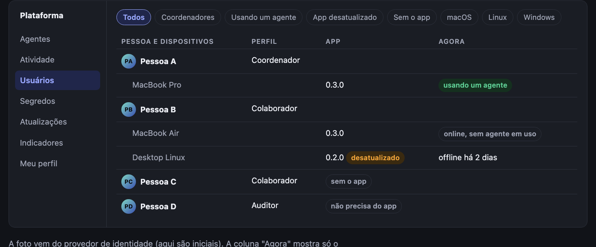

A coluna "Agora" mostra só o estado deste momento, sem histórico por pessoa. O
app não registra o que a pessoa faz na máquina.

| Perfil | O que faz | O que não faz |
|---|---|---|
| Proprietário | Tudo o que o coordenador faz, mais configurar a plataforma | |
| Coordenador | Aprova. Recebe os avisos de PR e de ações dos agentes nas ferramentas. Cria e organiza os agentes do time | Não muda a configuração da plataforma |
| Colaborador | Tem o app na máquina, cria agentes só para si e pede aprovação | Não cria agente para o time. Não aprova o próprio pedido nem o dos outros |
| Auditor | Vê indicadores, alertas e o registro de atividade | Não muda nada e não aprova |

Os perfis vêm dos grupos do provedor de identidade da empresa. Para PRs, quem
pode aprovar continua sendo regra do GitHub; o perfil decide quem recebe o card.

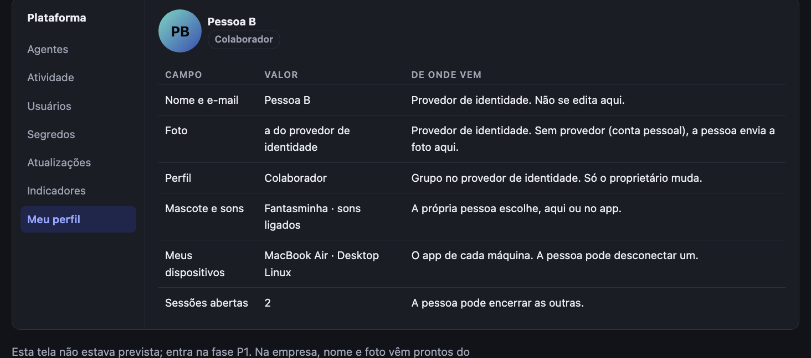

### Indicadores

Duas telas: gastos e agentes, e servidor. O gasto por agente aparece em barras
ou em círculo, à escolha.

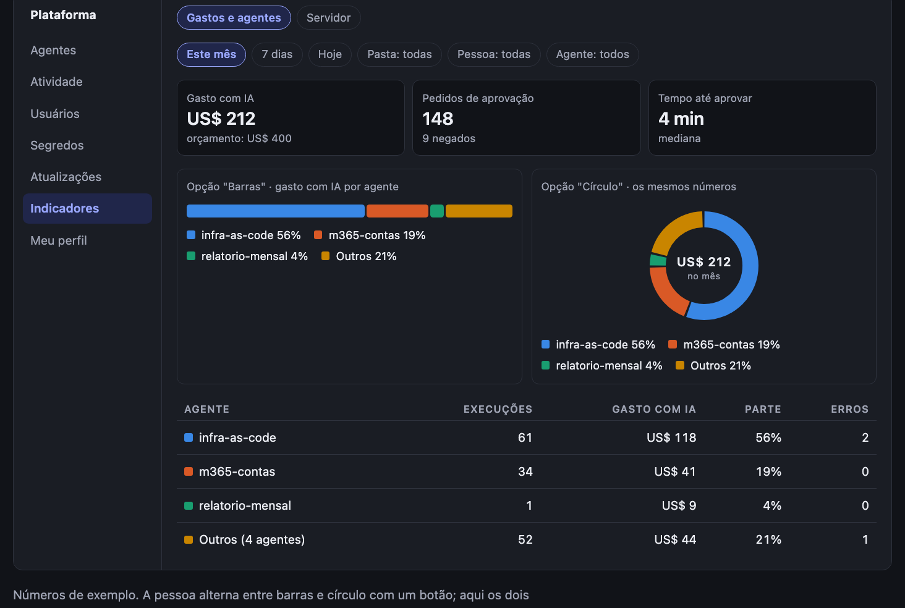

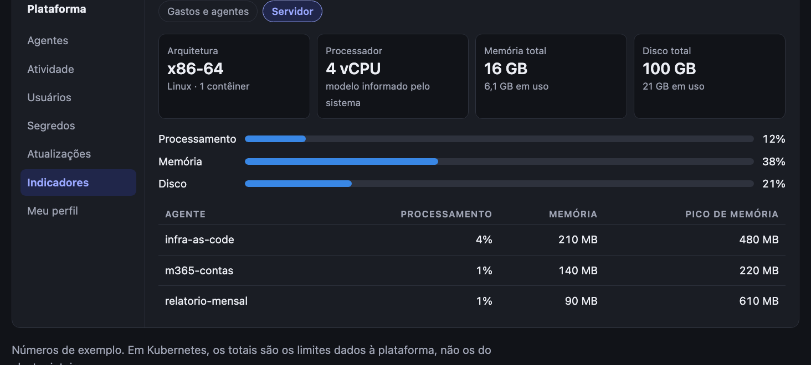

A plataforma entrega métricas e logs no formato padrão que o Grafana lê, com um
painel pronto. O Grafana por MCP é outra coisa: é ferramenta de consulta para os agentes.

## Como as mudanças chegam

Nada chega a todo mundo sem passar por um ambiente de teste e por uma aprovação.

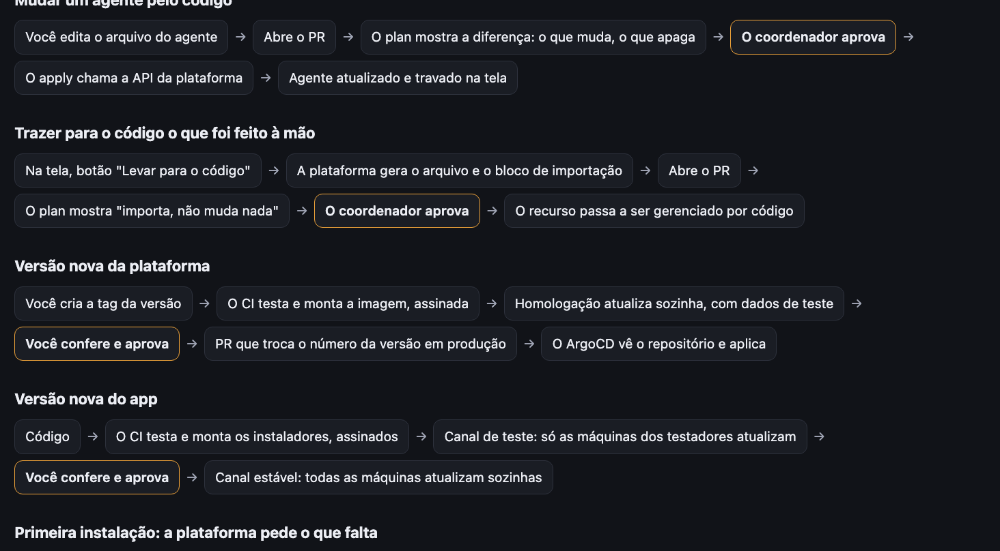

Tela ou função nova entra desligada: liga primeiro para os testadores e, depois
de aprovada, para todos. Hoje o app tem o CI e a assinatura; faltam o canal de
teste e o liga-desliga por função.

A primeira instalação da plataforma termina num passo a passo que pede o que falta.

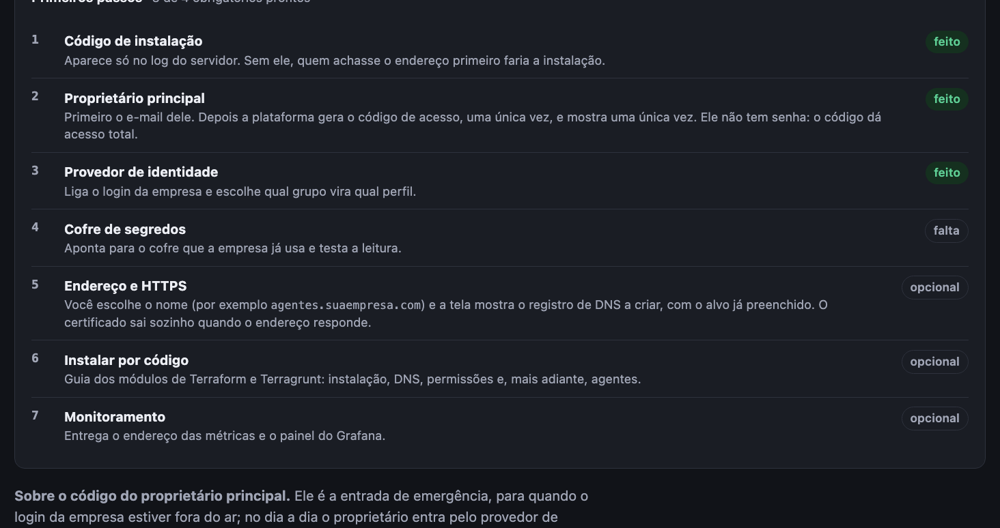

O código do proprietário principal é a entrada de emergência, para quando o login
da empresa estiver fora do ar. Cada uso avisa todos os proprietários e fica no registro.

## Regras de segurança

1. O app funciona sozinho. Conectar à plataforma é opcional e fica visível na tela.
2. A plataforma não guarda senha de ferramenta. O segredo fica no cofre que a
   empresa já usa. Cada agente tem identidade própria, com a menor permissão que resolve.
3. Toda mudança passa por PR, e todo PR tem aprovação de uma pessoa, em qualquer
   ambiente, inclusive homologação. Ação destrutiva também avisa o coordenador.
4. O app registra a ordem dada ao agente e o que ele fez. Não registra o que mais
   a pessoa faz na máquina.
5. A máquina só faz conexão de saída. Nada nela escuta a rede.
6. Na máquina, o agente usa a assinatura da própria pessoa. No servidor, chave de API.
7. Um agente gestor revisa e resume. Quem aprova é sempre uma pessoa.
8. Nem a plataforma nem os agentes têm permissão sobre o Kubernetes ou sobre a
   infraestrutura onde rodam. Mudar infraestrutura é só por PR.
9. Segredo tem prazo: o agente avisa antes de vencer e para de trabalhar se não
   for renovado. Dá para ligar e desligar por agente.
10. Toda aprovação registra quem aprovou e por onde: app, plataforma ou GitHub.
11. Estar na rede não dá acesso. Cada pedido confere a pessoa, o dispositivo e o perfil.

### Postura de segurança, configurável pelo proprietário

| Situação | De fábrica | O que o proprietário pode mudar |
|---|---|---|
| Entrar na plataforma | Só pelo provedor de identidade, com segundo fator | Somar condições: país, horário, grupo, rede da empresa |
| Dispositivo fora de conformidade | Só leitura | Bloquear, manter só leitura ou permitir com aviso |
| App desatualizado | Avisa e atualiza; depois de 7 dias a máquina deixa de aprovar | O prazo, e se bloqueia ou só avisa |
| Aprovar ação de perigo | Confirmação própria da ferramenta: digital do Mac, Windows Hello ou chave de acesso; onde não há, código de autenticador ou chave física | Exigir a mesma confirmação em mais lugares |
| Pessoa sai do grupo | A sessão cai em minutos e o app daquela máquina desconecta | O tempo de sessão |
| Rede | Nenhuma porta aberta para a internet | Pôr a plataforma atrás do acesso zero trust da empresa |

Não dá para desligar: ação de perigo sempre passa por uma pessoa, o registro de
atividade sempre grava, e segredo nunca fica na plataforma. A conformidade do
dispositivo vem do provedor de identidade ou da ferramenta que gerencia as
máquinas, não do app.

## Em aberto

- O registro dos nomes escolhidos em 23/11/2026, **Thalon** (o app) e **Thalon Hub**
  (a plataforma): domínio e consulta de marca. A troca no app é a fase A3 (#85).
- Como ligar um agente ao outro quando o primeiro chama o segundo pelo terminal.
- Os termos de uso das assinaturas de IA para agentes que rodam em servidor.
